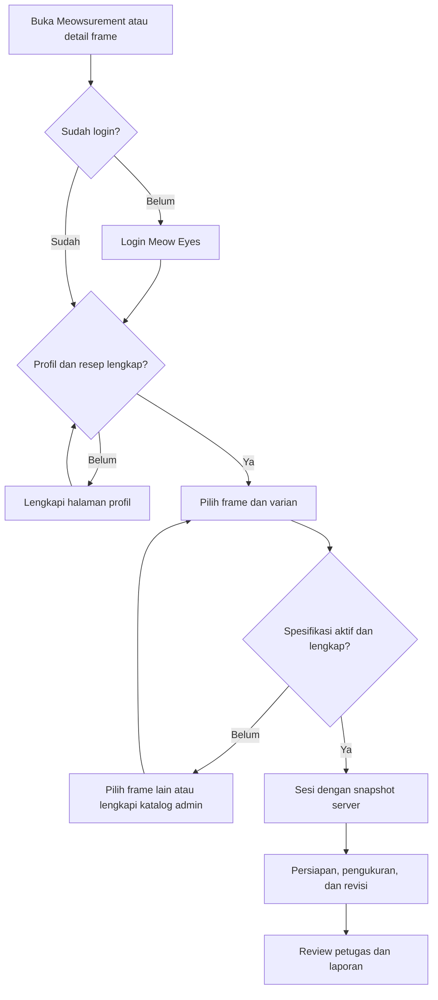

# Rancangan implementasi Meowsurement customer

> Pembaruan 10 November 2026: [menu kartu, form khusus, frame manual, ED opsional, dan kamera](CUSTOMER_FLOW.md). Head terbaru `20261110_0004`; SQL 004 melengkapi migrasi 0003 di bawah. Sesi manual memakai `product_id`/`variant_id` NULL dan `spec_scope=manual`.

## 1. Tujuan dan batas identitas

Satu identitas customer mengikuti `users.user_id` e-commerce. Customer mengelola informasi dirinya melalui profil website. Meowsurement membaca informasi tersebut, menyalin snapshot saat sesi dibuat, dan mengaitkan seluruh hasil pada akun yang sama. Istilah `patient` pada DTO laporan lama merupakan representasi snapshot customer, bukan entitas pendaftaran pasien baru.

Admin menggunakan dashboard e-commerce yang sudah ada untuk mengisi spesifikasi frame. Review menggunakan akun admin/staf website berizin. Tidak ada setup organisasi, administrator lokal, operator, atau patient roster pada flow aktif.

## 2. Diagram alur

## 3. Kelengkapan profil

| Data | Aturan |
| --- | --- |
| Nama | Berasal dari akun; wajib terisi |
| Email | Identitas akun yang sudah ada |
| Telepon dan tanggal lahir | Wajib sebelum membuat sesi |
| Tanggal resep | Wajib; tidak boleh di masa depan atau sebelum lahir |
| SPH dan CYL OD/OS | Kedua mata wajib terisi; `0` valid dan `NULL` berarti belum diisi |
| AXIS | Wajib 1–180 jika CYL tidak nol |
| ADD | Opsional sesuai resep; tidak diisi otomatis |
| PD | Opsional, total atau pasangan kanan/kiri; hanya referensi resep |
| Alamat dan gender | Opsional |

GET profil memberikan `ready` dan `missing_fields`. PUT menerima draft dengan `expected_version`; server menolak versi lama dengan 409. Perubahan resep membuat record baru pada tabel resep existing. Riwayat order dan sesi tidak diarahkan ulang ke resep baru.

## 4. Katalog frame

A/B/DBL/ED dan panjang tangkai adalah kolom numerik mm, bukan parsing teks marketing. Data default berada pada produk; override lengkap dapat diberikan per varian. Varian tanpa override mengikuti default. Aktivasi mengharuskan A/B/DBL/ED lengkap, positif, dan konsisten dengan aturan database.

Semua perubahan default atau varian menaikkan versi agregat spesifikasi produk. Pembuatan sesi mengirim ID produk/varian, `expected_profile_version`, dan `expected_spec_version`. Backend mengambil data sendiri; request customer tidak membawa identitas, resep, dimensi, atau status approval yang dapat dipercaya sebagai sumber.

## 5. Snapshot dan revisi

Sesi menyimpan pemilik, sumber resep, produk/varian, versi sumber, snapshot profil/resep, snapshot frame, tanggal, dan algoritma. Riwayat lama tidak berubah ketika customer memperbarui profil atau admin memperbarui katalog. Untuk memakai resep/frame baru, customer membuat sesi baru.

Setiap perubahan pengukuran merupakan revisi baru dengan alasan, aktor, waktu, parent, dokumen lengkap, dan nomor revisi. Pointer revisi saat ini diperbarui dalam transaksi. API memakai expected revision untuk mencegah penimpaan pekerjaan dari tab lain. Histori bersifat append-only pada MySQL; perubahan kondisi pengukuran mengembalikan status ke draft dan membatalkan hasil yang konteksnya sudah berubah.

Frame dan resep dalam revisi harus cocok dengan snapshot server. Capture, pengukuran, dan hubungan hasil-ke-capture juga disimpan sebagai tabel relasional; ID bukti dari pemilik, sesi, atau revisi lain ditolak.

## 6. Komponen aplikasi

| Lapisan | Implementasi |
| --- | --- |
| Entry privat | `frontend/src/optifit/entry.jsx` memasang `CustomerMeowsurementApp` |
| Profil website | `CustomerProfileForm`, `/profile`, helper kelengkapan |
| Katalog admin | `FrameSpecificationEditor`, aksi Meowsurement di admin produk |
| Detail produk | `ProductMeowsurement`, link produk/varian dan spesifikasi efektif |
| State terhubung | `ServerWorkspace`: login existing, request privat, history/revision, RAM foto sementara |
| Fitting | Komponen persiapan, kamera, landmark, hasil, dan laporan yang sudah ada |
| API | `routes_meowsurement.py`, kontrak Pydantic, `mysql/meowsurement.py` |
| Verifikasi hasil | `mysql/meowsurement_policy.py`, perhitungan geometri/provenans di server |
| Model/DDL | `meowsurement_models.py`, Alembic 0003 dan SQL 003 |
| Review | Dashboard `/admin/meowsurement` dan entry `?review_session=...` |

Parameter `review_session` bukan izin akses. Backend selalu memeriksa pemilik atau izin reviewer. Akun petugas dapat membuka review tanpa memenuhi gate profil pasien untuk dirinya sendiri.

## 7. Kontrak endpoint

Semua path berikut berada di bawah `/api`.

| Metode dan path | Fungsi |
| --- | --- |
| GET/PUT `/customer/profile` | Profil dan resep customer terautentikasi |
| GET `/products/{id}/frame-specification` | Spesifikasi katalog publik untuk produk aktif |
| GET/PUT `/admin/products/{id}/frame-specification` | Spesifikasi dengan izin produk dashboard |
| GET `/meowsurement/bootstrap` | Akun, kesiapan profil, kemampuan review, konfigurasi |
| GET `/meowsurement/frames` | Pencarian frame, `product_id` opsional, pagination |
| GET/POST `/meowsurement/sessions` | Riwayat customer dan sesi baru |
| GET `/meowsurement/sessions/{id}` | Snapshot, revisi, review, metadata foto sesuai hak akses |
| POST `/meowsurement/sessions/{id}/revisions` | Revisi append-only |
| POST `/meowsurement/sessions/{id}/submit` | Validasi hasil dan pengajuan review |
| POST `/meowsurement/sessions/{id}/reviews` | Keputusan petugas web independen |
| POST `/meowsurement/sessions/{id}/exports` | Otorisasi/audit ekspor revisi tertentu |
| POST `/meowsurement/sessions/{id}/photos` | Upload privat dengan persetujuan terpisah |
| GET/DELETE `/meowsurement/sessions/{id}/photos/{photo_id}` | Baca/penghapusan berotorisasi |
| GET `/admin/meowsurement/sessions` | Antrean review dengan filter dan pagination |

Pagination memakai `page`, `page_size`, `total`, `total_pages`. Kelengkapan yang gagal mengembalikan field yang kurang; 409 menandakan versi data berubah dan memerlukan reload. Tidak ada fallback yang menyimpan data ke vault lokal bila server gagal.

## 8. Persetujuan, foto, dan laporan

Persetujuan pengambilan gambar/hasil wajib sebelum capture. Upload foto bersifat opt-in dan disimpan pada revisi. Bila tidak dipilih, foto hanya ada di RAM sampai reload/penutupan dokumen. Hasil dan titik ukur yang berhasil disimpan tetap dapat dibaca dari riwayat; foto perlu diambil ulang untuk koreksi visual setelah reload.

Upload privat memeriksa owner sebelum decode, membatasi ukuran/resolusi, membersihkan metadata, dan menyimpan hash sumber serta hash berkas hasil normalisasi. Akses foto tidak menggunakan URL publik. Thumbnail laporan memerlukan consent revisi dan konfirmasi ekspor tersendiri; default laporan tanpa foto.

PDF/CSV/JSON/print memakai snapshot sesi/revisi yang dipilih. Event ekspor harus berhasil diotorisasi server sebelum download/cetak dilakukan. Status approved hanya berlaku pada revisi dan scope yang direview. Review customer sendiri ditolak.

## 9. Batas mode offline dan versi sebelumnya

Cache service worker menyimpan aset statis saja. Data akun dan mutasi membutuhkan API; frontend menampilkan kondisi koneksi dan kesalahan penyimpanan. Menyembunyikan tab menutup tampilan data serta kamera, dan melanjutkan memvalidasi kembali login Meow Eyes. Tombol ini bukan login lokal tambahan.

Source vault lama belum dihapus agar artefak sebelumnya tidak kehilangan kompatibilitas kode, tetapi tidak dipasang pada entry aktif. Migrasi MySQL tidak membaca IndexedDB atau backup lokal. Migrasi data historis lokal, jika diperlukan, membutuhkan inventaris/pemetaan pemilik dan proses impor terpisah yang eksplisit.

## 10. Rujukan teknis

Skema rinci, FK, tipe, guard, dan perintah upgrade berada pada [SCHEMA](SCHEMA.md). Geometri kamera dan batas algoritma berada pada [MEASUREMENTS](MEASUREMENTS.md); protokol pembandingan alat berada pada [FIELD_VALIDATION_PROTOCOL](FIELD_VALIDATION_PROTOCOL.md). Bukti pengujian yang dijalankan dilaporkan pada [VALIDATION](VALIDATION.md).
