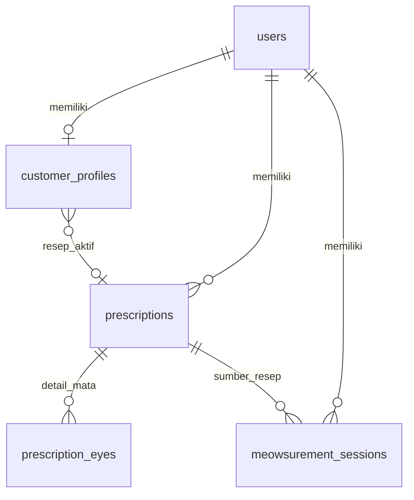
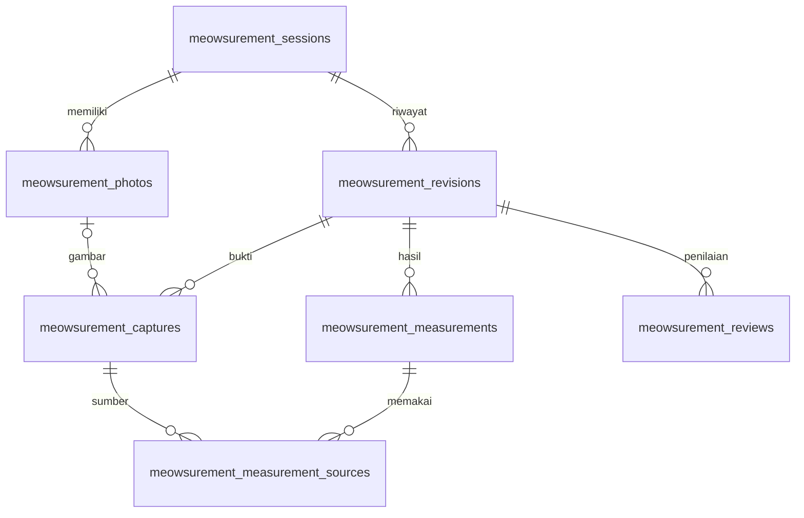

# Meowsurement — database customer dan migrasi MySQL 5.7.24-log

> Pembaruan 10 November 2026: [menu kartu, form khusus, frame manual, ED opsional, dan kamera](CUSTOMER_FLOW.md). Head terbaru `20261110_0004`; SQL 004 melengkapi migrasi 0003 di bawah. Sesi manual memakai `product_id`/`variant_id` NULL dan `spec_scope=manual`.

## 1. Keputusan arsitektur

Meowsurement menggunakan **akun customer Meow Eyes yang sudah ada**, profil
customer, resep kacamata, dan spesifikasi frame dari katalog e-commerce.
Identitas pasien merupakan representasi profil customer pada sesi pengukuran.
Tidak ada proses membuat organisasi, akun administrator lokal, akun operator
lokal, atau data pasien terpisah untuk memakai fitur ini.

Rancangan ini sudah menjadi model SQLAlchemy dan migrasi aplikasi, dengan head
Alembic **`20261109_0003`**. Migrasi menambahkan **11 tabel** pada 68 tabel
e-commerce: total **79 tabel aplikasi**, di luar `alembic_version`. Tabel
`users`, `prescriptions`, `prescription_eyes`, `products`, `product_variants`,
dan `user_permissions` digunakan kembali.

Dokumen ini menggantikan rancangan sinkronisasi opsional `of_*` sebelumnya.
Migrasi 0003 tidak membuat maupun menghapus tabel `of_*`, tidak mengimpor vault
IndexedDB lama, dan tidak menyalin akun/pasien lokal ke customer secara otomatis.
Jika rancangan lama pernah diterapkan sendiri pada suatu database, tabel tersebut
harus diinventarisasi terpisah; jangan menganggapnya sebagai data milik customer
tertentu tanpa pemetaan pemilik yang terverifikasi.

### Sumber implementasi

| Berkas | Fungsi |
| --- | --- |
| `backend/mysql/meowsurement_models.py` | Model relasional runtime, FK, indeks, dan aturan data |
| `backend/migrations/versions/20261109_0003_customer_meowsurement.py` | Migrasi dengan definisi DDL dan trigger yang dibekukan |
| `backend/sql/003_customer_meowsurement.sql` | SQL upgrade `20261106_0002` → `20261109_0003` |
| `docs/optifit/SCHEMA_MYSQL57.sql` | Salinan SQL migrasi tersebut untuk paket dokumentasi |
| `backend/mysql/meowsurement.py` | Akses profil/katalog, pembuatan sesi, revisi, otorisasi, dan validasi server |
| `backend/mysql/check_integrity.py` | Pemeriksaan read-only tabel, aturan data, dan definisi trigger |

## 2. Alur sumber data

Customer masuk menggunakan autentikasi website yang sudah ada. Sebelum sesi
dibuat, server membaca profil customer dan memeriksa kelengkapannya. Jika belum
lengkap, API mengembalikan daftar field yang kurang dan alamat `/profile`.
Customer melengkapi profil/resep, lalu kembali memilih frame dari katalog.

Data yang wajib untuk memulai sesi adalah nama, nomor telepon, tanggal lahir,
tanggal resep, serta SPH dan CYL untuk mata kanan/OD dan kiri/OS. AXIS diperlukan
jika CYL tidak nol. Nilai nol yang sengaja diisi merupakan data valid; field
kosong tetap `NULL` dan tidak diubah menjadi nol. ADD, PD yang sudah diketahui,
alamat, dan gender dapat disimpan pada profil tanpa dijadikan prasyarat untuk
semua jenis pengukuran.

Server mengambil frame aktif dan varian aktif dari katalog. Dimensi A, B, DBL,
dan ED harus lengkap, bernilai positif, dan diaktifkan oleh administrator web.
Server membuat snapshot identitas/resep dan snapshot frame pada sesi baru.
Perubahan profil atau katalog setelah itu tidak mengubah sumber pengukuran sesi
lama. Customer yang ingin memakai resep atau ukuran frame baru membuat sesi baru.



Hubungan resep aktif dan sesi membawa `user_id` dalam composite foreign key.
Resep customer lain tidak dapat dipasang pada profil atau sesi hanya dengan
mengetahui ID resep tersebut.

## 3. Inventaris 11 tabel baru

| Tabel | Isi | Relasi dan aturan utama |
| --- | --- | --- |
| `customer_profiles` | Kontak, tanggal lahir, gender, alamat, resep aktif, tanggal resep, versi profil | Satu baris per `users.user_id`; resep aktif harus milik customer yang sama |
| `product_frame_specifications` | Dimensi frame default dan status Meowsurement | Satu baris per `products.id`; hanya produk bertipe `frame` |
| `product_variant_frame_specifications` | Override dimensi per varian | Varian harus milik produk yang sama; tanpa baris override berarti memakai default produk |
| `meowsurement_sessions` | Customer, produk/varian, sumber resep, snapshot, status, revisi aktif, versi sumber | FK kepemilikan resep/varian; sumber dan snapshot tidak dapat diubah |
| `meowsurement_revisions` | Dokumen pengukuran lengkap per revisi, parent, pembuat, alasan, versi algoritma | Append-only; nomor revisi unik per sesi; parent pada sesi/customer yang sama |
| `meowsurement_photos` | Metadata penyimpanan privat, hash, dimensi, consent, retensi, tombstone | Foto terikat pada pemilik/sesi; bytes disimpan di penyimpanan privat, bukan JSON/URL publik |
| `meowsurement_captures` | Akuisisi per revisi: view, ukuran, waktu, kalibrasi, landmark, quality, foto | Capture terikat pada revisi/sesi/customer; foto harus berasal dari sesi/customer yang sama |
| `meowsurement_measurements` | Parameter, sisi, satuan, metode, hasil, quality, versi algoritma | Maksimal satu hasil per parameter per revisi; append-only |
| `meowsurement_measurement_sources` | Hubungan hasil dan capture sumber | Kedua sisi FK membawa `revision_id`; bukti dari revisi lain ditolak |
| `meowsurement_reviews` | Keputusan, catatan/bukti, reviewer web, target revisi | Reviewer aktif dan berwenang; bukan customer pemilik atau pembuat revisi; append-only |
| `meowsurement_audit_events` | Aktor, tindakan, waktu, detail, target sesi/revisi | Append-only; target revisi/sesi harus milik customer yang sama |

Tabel pengukuran menggunakan ID acak penuh, tidak dipotong dari UUID dan tidak
diturunkan dari nama, telepon, atau tanggal lahir. Kolom identitas memakai
`VARCHAR(64)` dengan `utf8mb4_bin` untuk perbandingan identitas yang konsisten.

## 4. Profil customer dan riwayat resep

`customer_profiles.user_id` adalah primary key sekaligus FK ke akun e-commerce.
Profil boleh belum ada pada akun lama; respons pembacaan profil mengembalikan
versi `0`, field kosong, dan daftar kelengkapan yang diperlukan. Baris pertama
yang disimpan mulai dari versi `1`. Pengeditan berikutnya meningkatkan versi.
Request harus membawa versi yang sebelumnya dibaca untuk mencegah penimpaan
perubahan dari tab atau perangkat lain.

| Kolom profil | Tipe | Keterangan |
| --- | --- | --- |
| `user_id` | `VARCHAR(64)` | PK/FK pemilik akun |
| `phone` | `VARCHAR(32) NULL` | Nomor kontak yang divalidasi API |
| `birth_date` | `DATE NULL` | Tidak boleh di masa depan menurut validasi API |
| `gender` | `VARCHAR(20) NULL` | `male`, `female`, atau `unspecified` |
| `address` | `TEXT NULL` | Alamat profil; tidak menggantikan address book checkout |
| `active_prescription_id` | `VARCHAR(64) NULL` | Resep aktif milik customer yang sama |
| `prescription_date` | `DATE NULL` | Tanggal resep aktif, divalidasi terhadap tanggal lahir dan hari ini |
| `version` | `INT` | Bilangan positif untuk kontrol perubahan |
| `created_at`, `updated_at` | `DATETIME(6)` | Waktu UTC |

Nama dan email tetap berasal dari `users`; tidak dibuat salinan identitas yang
harus dipelihara pada tabel pasien. Resep tetap menggunakan tabel yang sudah ada:

- `prescriptions`: pemilik, PD total **atau** pasangan PD kanan/kiri, catatan,
  referensi lampiran resep, dan penanda snapshot pesanan.
- `prescription_eyes`: satu baris `right` dan satu `left`, berisi SPH, CYL, AXIS,
  serta ADD. SPH/CYL/ADD menggunakan `DECIMAL`; AXIS berupa bilangan bulat.

Perubahan resep melalui API profil membuat record resep pengganti dan menggeser
`active_prescription_id`. Record yang sudah direferensikan sesi/pesanan tetap
tersimpan. Snapshot lengkap di sesi melindungi interpretasi riwayat, termasuk
ketika ada perubahan data sumber oleh proses lain. Migrasi tidak memilih resep
checkout lama sebagai resep aktif secara spekulatif.

## 5. Spesifikasi frame dari administrator e-commerce

Kedua tabel spesifikasi mempunyai kolom ukuran yang sama:

| Kolom | Tipe | Makna |
| --- | --- | --- |
| `a` | `DECIMAL(7,2) NULL` | Ukuran horizontal lensa dalam sistem boxing, mm |
| `b` | `DECIMAL(7,2) NULL` | Ukuran vertikal lensa, mm |
| `dbl` | `DECIMAL(7,2) NULL` | Jarak antar lensa/bridge dalam sistem boxing, mm |
| `ed` | `DECIMAL(7,2) NULL` | Effective diameter, mm |
| `temple_length` | `DECIMAL(7,2) NULL` | Panjang tangkai, mm |
| `symmetric` | `BOOLEAN` | Pernyataan admin tentang simetri frame |
| `enabled` | `BOOLEAN` | Apakah spesifikasi boleh dipakai untuk Meowsurement |
| `source_note` | `TEXT NULL` | Asal spesifikasi/catatan pengukuran |
| `version` | `INT` | Versi positif |
| `updated_by` | `VARCHAR(64) NULL` | Akun web yang memperbarui spesifikasi |
| `created_at`, `updated_at` | `DATETIME(6)` | Waktu UTC |

Baris varian merupakan override lengkap, bukan campuran field parsial dari dua
ukuran frame. Tanpa baris varian, layanan menggunakan spesifikasi produk.
Penghapusan override mengembalikan penggunaan default produk. Versi pada default
produk menjadi versi agregat yang dinaikkan juga ketika override varian berubah,
sehingga pemilihan frame dapat mendeteksi katalog yang sudah berubah.

Dimensi yang belum diisi tetap `NULL`, dan `enabled` default `false`. Migrasi
tidak menebak B/ED dari string ukuran pemasaran seperti `52-18-140`, gambar,
atau data produk lain. Administrator melengkapi ukuran yang benar sebelum
mengaktifkan frame.

## 6. Sesi, revisi, bukti, dan review

Sesi menyimpan `user_id`, `product_id`, `variant_id`, `prescription_id`,
`profile_version`, `spec_version`, `spec_scope`, tanggal pemeriksaan,
`algorithm_version`, `profile_snapshot`, `frame_snapshot`, dan metadata
perangkat. Kolom sumber/snapshot dikunci oleh trigger UPDATE MySQL. Informasi
yang sedang dikerjakan disimpan sebagai revisi baru, bukan menimpa riwayat.

`current_revision_id` dan `revision_number` harus menunjuk revisi yang sama pada
sesi/customer tersebut. FK ini ditambahkan setelah tabel revisi dibuat untuk
mengatasi siklus relasi. Saat transaksi menyimpan revisi, layanan melakukan
flush revisi terlebih dahulu, baru memperbarui pointer sesi.



Revisi menyimpan dokumen kanonis lengkap pada `data JSON`. Capture, hasil, dan
hubungan bukti juga dinormalisasi agar integritas relasi tidak hanya bergantung
pada ID di dalam JSON. JSON berisi struktur yang bervariasi seperti landmark,
kalibrasi, nilai hasil, quality, dan detail perangkat; API tetap memvalidasi
struktur, ukuran payload, serta hubungan data sebelum transaksi disimpan.

View capture yang diterima adalah `frontal`, `frontal_near`,
`three_quarter_left`, `three_quarter_right`, `lateral_left`, dan `lateral_right`.
Keberadaan view dalam database tidak menyatakan bahwa semua parameter dapat
dihitung secara valid dari view tersebut.

Parameter hasil adalah `distance_pd`, `near_pd`, `vertex_right`, `vertex_left`,
`pantoscopic_right`, `pantoscopic_left`, `wrap_right`, dan `wrap_left`. Satuan
tersimpan adalah `mm` atau `deg`. Metode, versi algoritma, flag valid, nilai,
dan bukti kualitas tetap disimpan bersama hasil.

Status sesi adalah `draft`, `pending_review`, `needs_verification`,
`needs_remeasure`, atau `approved`. Status selain draft memerlukan revisi aktif;
approval memerlukan review approved pada revisi tersebut. Reviewer menggunakan
akun web aktif dengan role `admin`/`super_admin`, atau `staff` yang mempunyai
permission `meowsurement.review`. Tidak dibuat login reviewer/operator lokal.
Reviewer harus berbeda dari pemilik sesi dan pembuat revisi yang dinilai.

Trigger MySQL menolak UPDATE/DELETE terhadap revisi, capture, hasil, hubungan
sumber, review, dan audit. Koreksi dilakukan dengan revisi baru. Aturan otorisasi,
kelengkapan profil, validitas algoritma, dan transisi proses juga diperiksa oleh
API; trigger bukan pengganti validasi tersebut.

## 7. Foto privat dan retensi

Foto ditempatkan pada penyimpanan privat dengan metadata `storage_path` di
`meowsurement_photos`. Endpoint baca harus mengotorisasi pemilik/reviewer;
lokasi storage tidak diperlakukan sebagai URL media publik. Database tidak
menyimpan bytes gambar dalam profil, revisi, ataupun kolom JSON.

`source_sha256` menyimpan hash bytes sumber upload untuk mengikat bukti capture.
`sha256` menyimpan hash file hasil normalisasi yang disimpan server. Keduanya
berbeda karena pembersihan metadata dan encoding ulang dapat mengubah bytes.
Foto membutuhkan consent eksplisit, ukuran positif maksimal 20 juta piksel,
dan metadata ukuran file maksimal 8 MiB. Tipe yang diterima oleh skema adalah
JPEG, PNG, atau WebP; API dapat menormalisasi hasil penyimpanan ke JPEG.

`expires_at` mengatur batas retensi, dan `deleted_at` menjadi tombstone sesudah
penghapusan bytes. Identitas, sumber, hash, dimensi, consent, dan waktu pembuatan
foto tidak dapat diubah; tombstone yang sudah terisi tidak dapat dikembalikan
menjadi aktif. Metadata referensi dipertahankan agar riwayat tetap dapat dibaca.
Penyimpanan privat bukan klaim enkripsi end-to-end: perlindungan at-rest serta
akses administrator database/storage mengikuti konfigurasi deployment.

## 8. Kompatibilitas MySQL 5.7.24-log

Semua tabel baru menggunakan InnoDB, `utf8mb4_unicode_ci`, dan
`ROW_FORMAT=DYNAMIC`. ID/hash menggunakan collation `utf8mb4_bin`. Ukuran optik
menggunakan `DECIMAL`, waktu menggunakan `DATETIME(6)` UTC, dan dokumen menggunakan
JSON native yang tersedia pada target 5.7.24.

DDL tidak bergantung pada enforcement `CHECK`, CTE, window function, functional
index, atau default literal untuk TEXT/JSON. Metadata SQLAlchemy mempunyai 25
aturan CHECK baru untuk dokumentasi dan pengujian portable, tetapi compiler
menghilangkannya dari DDL MySQL. Migrasi memasang **27 trigger** untuk aturan
baris dan perlindungan riwayat. Dengan 0002, totalnya adalah **122 aturan baris
dan 117 trigger**. Pemeriksaan setelah migrasi membandingkan definisi trigger,
SQL mode, dan urutan eksekusi guard.

Migrasi menggunakan definisi tabel dan trigger yang dibekukan, bukan
`Base.metadata.create_all()`. Model boleh berkembang setelah rilis tanpa
mengubah hasil replay migrasi lama. File 0001/0002 dan SQL baseline tidak
ditimpa; SQL 003 adalah upgrade tambahan.

## 9. Menjalankan migrasi

Jalankan pada salinan database yang sudah dibackup dan diverifikasi dahulu.
Target lama yang dimaksud mempunyai head `20261106_0002`. Konfigurasi koneksi
mengikuti `backend/.env.mysql.example`; gunakan akun migrasi stabil yang dapat
membuat tabel, FK, indeks, dan trigger. Hentikan penulis selama proses DDL.

### Jalur Alembic yang dianjurkan

```bash
cd backend
python -m alembic current
python -m mysql.check_integrity --preflight-only
python -m alembic upgrade head
python -m mysql.check_integrity
```

Sesudah berhasil, `alembic current` harus menunjukkan `20261109_0003`, audit
menghasilkan `ok: true`, dan pemeriksaan readiness aplikasi menerima head
tersebut. Database baru dapat dibuat dengan `alembic upgrade head`; Alembic
menjalankan 0001 → 0002 → 0003. Akun aplikasi tidak perlu privilege TRIGGER
untuk memeriksa readiness biasa.

### Jalur SQL manual untuk target yang sudah berada pada 0002

Gunakan jalur ini sebagai alternatif Alembic, bukan dijalankan lagi setelah
Alembic berhasil. Periksa `SELECT version_num FROM alembic_version` dan pastikan
nilainya tepat `20261106_0002`; pastikan 11 tabel baru belum ada. SQL yang sama
tersedia di `backend/sql/003_customer_meowsurement.sql` dan
`docs/optifit/SCHEMA_MYSQL57.sql`.

```bash
mysql --show-warnings -h DB_HOST -u MIGRATION_USER -p DB_NAME < sql/003_customer_meowsurement.sql
python -m mysql.check_integrity
```

SQL mengatur SQL mode ketat, zona waktu UTC, InnoDB strict mode, memasang tabel
dan trigger, serta memperbarui `alembic_version`. Gunakan client yang memahami
`DELIMITER`. Jangan gunakan `mysql --force` dan jangan melakukan `stamp` ketika
migrasi gagal.

MySQL 5.7 melakukan implicit commit untuk DDL. Jika terputus di tengah,
Alembic 0003 menolak percobaan ulang yang menemukan tabel baru sebagian agar
tidak menimpa data/struktur yang belum diperiksa. Pulihkan target latihan dari
backup atau evaluasi langkah yang sudah terpasang bersama DBA. Jangan menghapus
tabel secara otomatis dari database produksi untuk melewati pemeriksaan ini.

Downgrade 0003 menghapus 11 tabel dan seluruh data Meowsurement di dalamnya.
Eksekusi online hanya tersedia dengan flag eksplisit
`-x allow_schema_drop=true`, untuk target disposable/restored yang memang akan
dihapus. Untuk pemulihan produksi, gunakan backup yang telah diverifikasi.

### Setelah migrasi

Customer lama dapat melengkapi profil dan memilih resep aktif. Administrator
melengkapi dan mengaktifkan spesifikasi frame. Tidak diperlukan seed organisasi,
akun operator, pasien, atau resep/frame contoh. Hak review diberikan pada akun
web yang sudah ada bila alur review digunakan.

## 10. Batas verifikasi

Pengujian schema mencakup DDL MySQL yang dihasilkan, perbandingan export terhadap
migrasi yang dibekukan, ukuran key/index, urutan FK/downgrade, aturan ownership
antar customer/sesi/revisi, sumber bukti, dan aturan data portable pada SQLite.
Pengujian tersebut tidak menjalankan trigger MySQL native atau membuktikan
locking/collation pada server produksi. Uji upgrade lengkap pada instance
MySQL **5.7.24-log** staging serta audit pascamigrasi tetap merupakan pemeriksaan
deployment sebelum penerapan produksi.

## Referensi MySQL

[MySQL 5.7 Reference Manual](https://downloads.mysql.com/docs/refman-5.7-en.pdf), bagian CREATE/ALTER TABLE, menjelaskan bahwa CHECK diparse tetapi diabaikan. Karena itu DDL 0003 memakai guard trigger untuk enforcement, bukan menganggap CHECK SQLAlchemy aktif pada MySQL 5.7.
