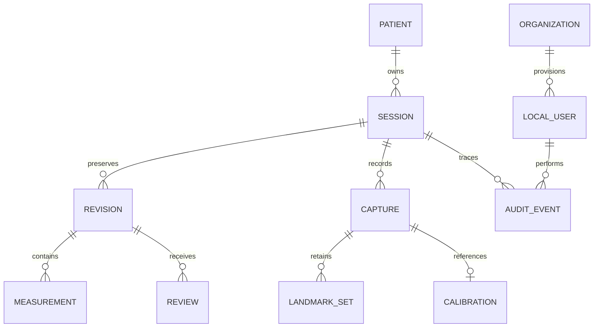

> Arsip implementasi vault lokal sebelumnya. Dokumen ini tidak menjadi petunjuk alur customer saat ini. Gunakan [dokumentasi aktif](../README.md).

# Meowsurement — rancangan produk dan implementasi

Tanggal rancangan: 9 November 2026 (Asia/Jakarta). Sumber: spesifikasi pengguna
715 baris pada lampiran terbaru. Dokumen ini ditulis sebelum implementasi modul.
Target adalah website/PWA berbahasa Indonesia yang ditambahkan pada proyek
Meow Eyes React + FastAPI dengan database server Oracle MySQL 5.7.24-log.

## 1. Ringkasan pemahaman produk

OptiFit mencatat pasien, resep OD/OS, dimensi frame, dan hasil fitting. Resep
berasal dari input resep/pemeriksaan profesional. Kamera membantu pengambilan
gambar dan geometri fitting dengan kalibrasi; tidak menghasilkan SPH, CYL,
AXIS atau ADD. Pemakaian utama oleh operator saat frame telah disetel pada
pasien. Riwayat, koreksi, review dan laporan harus dapat ditelusuri.

Produk inti adalah modul offline dengan penyimpanan terenkripsi pada browser.
Koneksi akun Meow Eyes hanya untuk mengambil profil/katalog melalui tindakan
sadar pengguna. Tidak ada unggahan foto wajah atau sinkronisasi otomatis.

## 2. Asumsi dan batasan

- Website dipilih karena permintaan utama menyebut website. CameraX adalah
  teknologi Android; implementasi web memakai getUserMedia, canvas dan WebCrypto.
- Route khusus `/meowsurement/` mempunyai shell privat, tanpa WhatsApp,
  analytics, font atau model pihak ketiga yang dimuat ketika pengukuran berlangsung.
- HTTPS/localhost diperlukan. Penggunaan offline tersedia setelah aplikasi dan
  aset lokal disiapkan online pertama kali. IndexedDB dapat dibatasi/diusir oleh
  browser; aplikasi meminta persistent storage dan menyediakan backup terenkripsi.
- Database server e-commerce tetap MySQL 5.7.24-log. IndexedDB adalah lapisan
  lokal offline, bukan penggantian database server menjadi engine lain.
- Operator/customer menggunakan vault perangkatnya atau workspace optik dengan
  anggota yang diprovisi admin. Ini bukan portal lintas pelanggan dengan akses
  bebas ke pasien lain. Server multi-cabang membutuhkan otorisasi server tersendiri.
- Tidak semua perangkat memberikan intrinsics, depth, sensor orientasi atau jarak.
  Data tersebut berstatus tidak tersedia bila tidak ada, tidak disintesis.
- Mode manual lengkap dan bantuan kandidat pupil menjadi dasar MVP. Otomatis
  penuh, rekonstruksi wrap 3D, OCR tervalidasi dan biometric unlock tidak dipalsukan;
  kemampuan yang belum ada dinonaktifkan dengan alasan yang jelas.
- Skor kualitas 0–100 adalah ringkasan bukti teknik, bukan probabilitas benar atau
  klaim akurasi klinis. Ketidakpastian dilaporkan Tidak tersedia jika belum sah.
- Browser tidak dapat menjamin pemblokiran screenshot recent-apps atau penghapusan
  forensik memori/SSD. Mask privasi, auto-lock, penghapusan ciphertext dan backup
  terkontrol mengurangi paparan sesuai kemampuan web.

## 3. Risiko teknis dan klinis

| Risiko | Pengendalian |
| --- | --- |
| Kalibrasi berada pada bidang berbeda dari titik ukur | Konfirmasi same-plane, simpan metode, tolak kalibrasi tidak diketahui; hasil kamera tetap perlu verifikasi |
| Parallax, perspektif atau distorsi lensa | Gunakan marker planar; koreksi homography hanya pada bidang tersebut; jangan mengklaim rekonstruksi 3D |
| Konvergensi saat distance PD | Protokol target jauh dan konfirmasi arah pandang; near mempunyai jarak kerja terpisah |
| Pupil tertutup atau refleksi | Kandidat awal harus dikonfirmasi; titik manual dan pengambilan ulang tersedia |
| VD diukur ke depan frame | Wajib apex kornea dan permukaan belakang lensa; surrogate tidak diterima tanpa offset tervalidasi |
| Kepala miring pada panto | Simpan arah inward, vertical reference, head pitch bersumber, nilai mentah dan terkoreksi |
| Skor dianggap akurasi klinis | Label kualitas teknik dan nilai uncertainty null; approval memerlukan reviewer dan bukti referensi |
| Perangkat hilang atau browser dibersihkan | AES-GCM, lock, backup terenkripsi, petunjuk persistensi; tidak ada recovery key tersembunyi |
| Pengguna mengedit JS/seluruh penyimpanan lokal | Audit hash-chain bersifat tamper-evident, bukan bukti independen tahan pemilik perangkat; anchoring server diperlukan untuk jaminan lebih kuat |
| Dua tab menimpa revisi | Commit atomik IndexedDB dengan versi yang diharapkan; konflik menghasilkan refresh, bukan last-write-wins |

## 4. Product Requirements Document

### Peran

Admin mengelola akun lokal, konfigurasi organisasi, pasien, retensi dan backup.
Operator (Customer Meow Eyes) mencatat pasien, resep/frame, foto, landmark,
revisi dan laporan draft. Reviewer membaca data dan membuat keputusan review;
review tidak mengubah raw payload. Admin tidak otomatis boleh menyetujui hasil
pengukurannya sendiri. Pembuat revisi terakhir tidak menjadi reviewer hasilnya.

### Functional requirements

FR01 identitas pasien otomatis/nomor rekam, nama, tanggal pemeriksaan; detail
opsional, profil foto hanya dengan persetujuan. FR02 resep OD/OS manual dan
transpose turunan tanpa overwrite. FR03 A/B/DBL/ED dalam mm dan Frame PD.
FR04 consent/checklist sebelum kamera. FR05 frontal jauh, optional frontal dekat,
3/4 kanan/kiri dan lateral kanan/kiri. FR06 burst multi-frame dan quality check.
FR07 dua jenis kalibrasi. FR08 independent monocular/binocular PD. FR09 lateral
VD/panto atau hasil instrument manual. FR10 wrap dari alat/metode independen
atau pipeline multi-view yang telah divalidasi, bukan foto frontal tunggal.
FR11 editor zoom/pan/magnifier/undo/redo dan riwayat. FR12 confidence/repeatability.
FR13 review/revisi. FR14 PDF/CSV/JSON/print setelah konfirmasi. FR15 vault offline,
lock, audit, retensi dan backup/restore terenkripsi. FR16 organisasi/cabang dan
identitas perangkat dicatat. FR17 integrasi profil/katalog eksplisit tanpa sync foto.

### Nonfunctional requirements

Tidak ada data dummy produksi. Pesan error tidak memuat resep/PIN/secret.
Nilai numerik finite dan input tervalidasi. Semua koordinat memakai pixel gambar
asli yang tidak dicerminkan. Mutasi atomik. Aksesibilitas label, keyboard, target
sentuh besar, kontras, light/dark dan layout mobile. Tidak ada API berbayar atau
cloud vision untuk fungsi inti. Setiap sesi menyimpan versi algoritma.

## 5. User flow

1. Buka modul; buat vault organisasi dan akun admin tanpa akun default.
2. Admin menambahkan operator/reviewer. Pengguna membuka vault dengan secret lokal.
3. Tambah pasien atau pilih riwayat; profil Meow Eyes dapat diambil atas permintaan.
4. Catat resep dan frame; simpan draft awal yang immutable.
5. Pilih scope pengukuran, konfirmasi consent/checklist dan target pandang.
6. Ambil burst tiap view; ulangi jika gagal. Retensi foto dipilih terpisah.
7. Tandai/konfirmasi marker dan landmark; jalankan perhitungan yang tersedia.
8. Koreksi dengan alasan; revisi baru menyimpan sebelum/sesudah.
9. Lihat hasil/repeatability/alasan kualitas. Lengkapi metode instrumen bila diperlukan.
10. Ajukan review. Reviewer dapat meminta ulang atau menyetujui berdasarkan bukti.
11. Konfirmasi ekspor, pilih format dan foto opsional yang diizinkan. Lock saat selesai.

## 6. Daftar layar

Unlock/setup; dashboard pasien; form pasien; riwayat pasien; data sesi/resep/frame;
persiapan/consent; wizard capture; editor titik/kalibrasi; hasil; review;
ekspor/cetak; pengaturan organisasi/pengguna/retensi/backup.

## 7. Wireframe tekstual tiap layar

| Layar | Susunan utama dan aksi |
| --- | --- |
| Setup/unlock | Nama aplikasi, tujuan/privasi, alias pengguna, secret, buka vault; setup organisasi/admin; status dukungan secure-context |
| Dashboard | Header offline/terenkripsi + lock + tema; pencarian pasien, Tambah pasien; daftar nama/nomor rekam/tanggal terakhir tanpa foto default |
| Form pasien | Wajib nama; nomor otomatis; tanggal pemeriksaan; detail opsional dalam bagian terpisah; consent foto; simpan/batal |
| Riwayat | Identitas ringkas; daftar sesi dengan tanggal/status; sesi baru; timeline revisi/review/audit |
| Data sesi | Stepper; tabel OD/OS; transpose sebagai perbandingan; frame A/B/DBL/ED; Frame PD readonly; scope, catatan dan simpan draft |
| Persiapan | Tujuan kamera + consent eksplisit; checklist lengkap; petunjuk target jauh/dekat; retensi; contoh posisi; siap/batal |
| Capture | Nama view + silhouette/crosshair; kualitas tersedia vs perlu diperiksa; manual/burst auto terbatas; ulang; thumbnail lokal privat |
| Editor | Gambar asli dengan zoom/pan/magnifier; daftar titik berlabel OD/OS; marker skala; before/after; undo/redo/reset; alasan dan simpan revisi |
| Hasil | Card PD, wrap, VD, panto, frame, resep, kualitas, catatan; raw/corrected; Tidak tersedia untuk metrik tanpa dasar |
| Review | Versi terkunci, bukti/metode, catatan reviewer; perlu ulang/verifikasi/setujui; tanpa edit raw |
| Ekspor | Format, status draft/final, consent thumbnail default off; konfirmasi tujuan ekspor; PDF/CSV/JSON/cetak |
| Pengaturan | Nama/logo optik, cabang, retensi, auto-lock; akun/role; backup terenkripsi/restore; penghapusan terkontrol; batas kemampuan |

## 8. Arsitektur aplikasi

UI memanggil service vault/domain dan modul vision lokal. Vision tidak mengakses
network/DB; menerima pixel dan evidence lalu mengembalikan hasil serializable.
Vault mengenkripsi payload/asset sebelum IndexedDB. Report menggunakan snapshot
revisi terpilih. Service worker hanya meng-cache application shell/aset statis,
bukan response API, foto, export atau state klinis. Integrasi profil/katalog
menggunakan API Meow Eyes melalui tindakan eksplisit; tidak ada antrean upload
background. Sinkronisasi server adalah adapter terpisah dan nonaktif dalam MVP.

## 9. Struktur modul dan folder

- `frontend/src/optifit/OptiFitApp.jsx`: shell dan orkestrasi UI.
- `frontend/src/optifit/components/`: form pasien/sesi/review/settings.
- `frontend/src/optifit/vision/`: calibration, math, image analysis, camera/editor.
- `frontend/src/optifit/storage/`: crypto, IndexedDB, vault, backup, audit.
- `frontend/src/optifit/domain/`: validasi resep/frame dan workflow review.
- `frontend/src/optifit/reports/`: PDF/CSV/JSON dan print.
- `frontend/src/optifit/integration.js`: profil/katalog eksplisit.
- `frontend/public/meowsurement/`: manifest dan service worker scoped.
- `docs/optifit/`: rancangan, schema, rumus, security, runbook, test/validation.

## 10. Entity Relationship Diagram

Ini adalah model logis. Persistensi fisik lokal membungkus graph entitas sebagai
state terenkripsi atomik ditambah encrypted photo objects; data klinis tidak
menjadi indeks plaintext IndexedDB.

## 11. Skema database

### IndexedDB MVP

`meta`: header vault/version, alias login, salt/KDF/wrapped DEK dan retry policy.
`state`: AES-GCM envelope berisi organization/settings/users/patients/sessions/
revisions/reviews/audit. `photos`: asset ID, encrypted bytes/IV/AAD; metadata
identitas pasien hanya di state terenkripsi. Header tidak berisi nama pasien.
State menggunakan compare-and-swap versi sebelum commit. Crypto dilakukan di
luar transaksi IDB; ciphertext + versi di-commit dalam satu transaksi.

### Entitas payload

Patient: id, recordNumber, fullName, customerId?, examinationDate, birthDate?,
sex?, phone?, address?, email?, occupation?, complaint?, notes?, photoConsent.
Session: id, patientId, examinationDate, raw immutable, currentRevisionId,
status, algorithmVersion, device, consents, createdBy/At.
Revision: id, sessionId, parentRevisionId, data lengkap, reason, actorId, createdAt.
Capture: id, view, photoId?, width/height, timestamp, device, quality analysis,
automaticPoints, points, calibrationSpec, confirmations, measurements.
Measurement: parameter, unit, method, values, quality, reasons,
uncertainty=null|supportedBudget, algorithmVersion, sourceCaptureIds, requiresReview.
Review: id, revisionId, reviewerId, decision, note, evidence, createdAt.
Audit: sequence, action, actorId, object IDs, timestamp, previousHash, hash.
Tidak menaruh foto/base64 atau secret di event audit.

### Server MySQL 5.7.24

Skema server opt-in dirancang pada dokumen SQL terpisah untuk organization,
membership, patient/session/revision/capture/measurement/review/audit. Payload
sensitif memakai ciphertext dengan metadata minimum. Tidak menjalankan DDL atau
mengunggah graph lokal secara otomatis. Migrasi server harus menjadi revisi
baru; dua revisi historis e-commerce tidak ditulis ulang. Sinkronisasi lintas
cabang beserta distribusi kunci/otorisasi merupakan acceptance terpisah sebelum
dihidupkan; backup terenkripsi lokal sudah menjadi jalur pemindahan MVP.

## 12. State dan event

Vault: uninitialized → locked → unlocking → unlocked; failure → locked/backoff;
hidden/idle/manual LOCK → locked dan camera stop. Mutasi setelah lock ditolak.

Session: draft → needs_remeasure / needs_verification / pending_review → approved.
NEW_REVISION dari hasil approved membuat draft baru dan tidak mengubah approval
versi sebelumnya. SUBMIT memeriksa data/bukti; REVIEW hanya untuk revisionId yang
masih current. REJECT meminta ulang; APPROVE memerlukan reviewer berbeda serta
kelengkapan scope/quality/reference. Low quality tidak auto-final. Draft tetap
bisa disimpan dan diekspor dengan watermark/status draft.

Capture: pending → camera_ready → capturing → captured → calibration_valid /
calibration_failed → annotated → measured. RETAKE membuat record baru; hasil lama
bertahan pada revisi/audit. DELETE_PHOTO menandai penghapusan yang disetujui,
mempertahankan metadata/hash dan nilai mentah yang diperlukan audit.

Export: requested → explicit_confirmed → generated → audited; cancellation
tidak menghasilkan download. Restore: selected → decrypt+validate → confirmed
admin operation → atomically replaced; kegagalan tidak merusak vault lama.

## 13. Kontrak interface computer vision

Seluruh titik `{x,y}` adalah pixel gambar asli tidak dicerminkan. Fungsi murni
`analyseImage(imageData)`, `suggestPupil(imageData, roi)`, `measurePD(input)`,
`measureVertex(input)`, `measurePantoscopic(input)`, `recordManualMeasurement(input)`,
`aggregateMeasurements(samples)`, `assessQuality(input)` mengembalikan hasil
serializable. Input salah menghasilkan `{valid:false,reasons:[...]}`. Hasil valid
menyertakan unit/method/algorithmVersion/uncertainty/requiresReview. Pupil
candidate adalah usulan, bukan pusat pupil yang otomatis disahkan.

CameraCapture menerima consent/checklist/view dan mengembalikan beberapa frame
asli, kualitas, ukuran dan device metadata. LandmarkEditor menerima points dan
automaticPoints; menghasilkan koreksi tanpa mengubah data awal. Kemampuan
`CAPABILITIES` menyatakan detector/depth/pose/multiview tersedia atau tidak.

## 14. Kontrak kalibrasi

`createCalibration({method,image,corners,widthMm,heightMm,segment,lengthMm,evidence})`.
Marker: empat sudut berurutan TL/TR/BR/BL dan lebar/tinggi fisik diketahui.
Frame: segment dengan panjang nyata, frontoparallel dan bidang relevan dikonfirmasi.
Evidence: knownSize, fullyVisible, samePlane, clearEdges, frontoparallel jika perlu.
Output `{valid,matrix,method,unit:'mm',image,reasons,limitations,algorithmVersion}`.
Tolak degeneracy, sudut di luar gambar, panjang nol, data tidak finite atau bukti
wajib yang belum dikonfirmasi. Homography memperbaiki satu bidang, tidak mengubah
foto menjadi depth map dan tidak menghilangkan parallax antarbidang.

## 15. Formula dan definisi

Frame PD = A + DBL; A horizontal lens box, B vertikal, ED effective diameter
(dimasukkan, tidak ditebak dari diagonal rectangle). Monocular PD adalah jarak
masing-masing pusat pupil ke midline yang ditentukan; binocular = kanan+kiri.
Roll dikoreksi terhadap midline; OD adalah kanan pasien, bukan kanan layar.
Near disimpan terpisah dengan workingDistanceCm wajib. Tidak menurunkan near PD
dengan pengurangan tetap dari far PD.

Untuk frame simetris dan PD yang referensinya bridge: decentration kanan =
(A+DBL)/2 - mono kanan; kiri serupa. Nilai positif berarti nasal/inward terhadap
lens-box center. Jika referensi wajah berbeda, decentration tidak dihitung sampai
referensi bridge dikonfirmasi. Total = Frame PD - binocular distance PD.

VD berasal dari lateral sisi yang sesuai: proyeksi vektor apex-kornea ke
permukaan belakang lensa sepanjang gaze direction pada bidang terkalibrasi.
Off-axis residual disimpan sebagai bukti geometri. Jangan memakai frontal.
Panto berasal dari sumbu lensTop/lensBottom versus vertical reference, dengan
inward direction eksplisit. Positif: bawah mendekat ke pipi. Simpan raw angle,
head pitch bersumber, corrected angle dan sign convention.
Wrap manual menyimpan kanan/kiri, instrumen/metode dan reference convention;
tidak merekayasa nilai dari kontur wajah atau frontal tunggal.

Transpose cylinder: S' = S+C; C' = -C; axis' = axis+90 dinormalisasi ke (0,180].
Resep asli tidak diubah. Tidak ada kompensasi kekuatan berdasarkan VD/panto/wrap.

## 16. Strategi confidence

Simpan komponen ketajaman, exposure, stabilitas, visibilitas pupil/frame,
refleksi, marker, scale consistency, pose, gaze, jarak dan perspektif. Komponen
yang tidak otomatis dideteksi ditandai sebagai konfirmasi operator atau tidak
tersedia. Skor teknik dan kategori bukan estimasi error mm/derajat.

Gunakan median beberapa sampel valid, MAD/variasi dan penolakan outlier yang
dicatat. Jangan memilih hasil paling dekat target. Report menyebut jumlah
sampel/repeatability; ini tidak diubah menjadi ketidakpastian klinis. Semua hasil
kamera MVP membutuhkan review dengan pembanding referensi; organisasi menentukan
protokol/toleransi lewat validasi, tanpa hardcoded target akurasi klinis.

## 17. Strategi keamanan

WebCrypto AES-256-GCM memakai IV acak baru dan authenticated additional data.
DEK vault acak dibungkus oleh kunci PBKDF2-HMAC-SHA256 600000 iterasi dengan salt
unik per akun. Secret lokal: passphrase minimal 12 karakter atau PIN numerik
minimal 10 digit dengan penjelasan kekuatan lebih rendah. Backup membutuhkan
passphrase nonnumerik minimal 12 karakter dan envelope baru.

Secret/kunci terbuka hanya selama unlock di memori, bukan localStorage.
Auto-lock idle/hidden menutup kamera dan menutupi UI. RBAC di mutation service,
revocation akun, dan review mengikat revisionId. Audit append-only pada aplikasi
dengan hash chain; tidak diklaim tahan manipulasi pemilik perangkat. HTTPS,
CSP/Permissions Policy yang sesuai deployment, tanpa CDN/analytics, validasi
import/export dan pengamanan CSV formula. Tidak ada kredensial default.

## 18. Strategi gambar

Foto kamera berupa blob lokal, bukan disimpan ke galeri. Simpan sebagai AES-GCM
ciphertext pada IndexedDB hanya sesuai persetujuan. Pisahkan consent capture,
retention, profil dan thumbnail export. Default tanpa foto pada laporan. Opsi
hapus setelah ekstraksi menyimpan landmark/quality/provenance dan deletion audit,
bukan foto. Blob URL dicabut ketika selesai/lock. Quota/retention failure jelas,
tidak fallback ke plaintext/localStorage/cloud. Retensi otomatis dijalankan saat
vault terbuka sehingga bisa mengaudit penghapusan; tidak menjanjikan background
purge ketika perangkat mati. Backup lama yang telah diekspor perlu dikelola
operator karena penghapusan browser tidak menghapus salinan di luar aplikasi.

## 19. Backlog MVP dan fase

P0/Fase1: vault, role, pasien, Rx/frame, riwayat, laporan dasar, domain validation.
P0/Fase2: getUserMedia, wizard multi-view, burst/quality, marker/frame calibration,
privasi gambar dan offline shell. P0/Fase3: kandidat pupil, manual corrections,
PD far/near, hasil/versioning/quality. P0/Fase4: lateral VD/panto dengan evidence,
manual instrument wrap dan repeatability; full automatic 3D reconstruction
merupakan extension yang memerlukan data kamera dan validasi, tidak dianggap selesai.
P0/Fase5 software: unit/UI/browser/security/workflow tests, protokol validasi.
Fase5 external: alat referensi, relawan berconsent, beragam perangkat/operator,
statistik bias/repeatability; tidak dapat digantikan fixture sintetis.
Fase6: backup terenkripsi dan profil/katalog eksplisit MVP; sinkronisasi server,
multi-cabang dengan key distribution dan review terpusat setelah penerimaan tersendiri.

## 20. Acceptance criteria dan traceability

| ID pengguna | Acceptance yang dibuktikan/ditargetkan |
| --- | --- |
| 1–4 | Registrasi pasien, Rx OD/OS, A/B/DBL/ED, Frame PD |
| 5–7 | Wizard frontal/lateral, quality blur/exposure, pose confirmation, kandidat pupil/manual |
| 8 | Kalibrasi tidak valid menghasilkan no-mm-result |
| 9–10 | Mono/binocular PD terpisah; wrap/VD/panto menyimpan metode camera/manual-instrument |
| 11–14 | Quality/status, retake, koreksi, audit tiap revisi |
| 15–18 | Offline setelah setup, encrypted storage, PDF dan riwayat |
| 19–25 | Gate reviewer/low quality, no camera Rx, consent/disclaimer, versioning, raw immutable, tanpa kewajiban depth |

Tidak menandai deteksi head-pose otomatis, wrap reconstruction otomatis,
biometrik atau akurasi klinis sebagai acceptance tercapai jika implementasi
hanya menyediakan konfirmasi manual atau rencana. Laporan validasi akhir
membedakan pengujian software, kemampuan yang tersedia, dan validasi lapangan.

## 21. Test plan

Unit: Rx invalid/null/axis/transpose, Frame PD/decentration, homography under
known transforms/degenerate/missing scale, side/sign of VD/panto, gaze/near
protocol, outlier/median and null uncertainty, session approval/stale revision.
Security: wrong credential/tampered ciphertext, roles, audit edits, rollback on
IDB conflict, lock during async mutation, encrypted photos/backup, restore wrong
password, delete/retention, no plaintext in IDB or caches, no network photo upload.
UI/browser: setup users; patient → Rx/frame → consent → local photo/camera →
calibration → correction → draft → reviewer → PDF/CSV/JSON; mobile/dark; offline
reload after installation; lock on hidden and camera permission denied; no dummy
production records. PDF pagination/long names/unicode/status/disclaimer checked.
Device/reference protocol: same/operator/device/light/frame repeats, all listed
frame materials/skin tones/pupil occlusions/head and phone tilt, front/back camera
and no-depth. Compare with calibrated pupillometer/VD/panto/wrap instruments.
Report bias, limits of agreement and repeatability only after collecting data;
predefine organization acceptance criteria before examining results.

## 22. Implementasi bertahap dan bukti

Kode ditambahkan setelah dokumen ini. Catatan file, cara menjalankan, batas
kemampuan dan hasil pengujian ditulis pada README/VALIDATION modul. Source
lengkap disertakan sebagai modul terpisah, bukan satu file raksasa. Tidak ada
foto pasien/dataset pelatihan atau hasil klinis palsu dalam build produksi.

## Referensi primer

- W3C Media Capture: https://www.w3.org/TR/mediacapture-streams/
- W3C Web Cryptography: https://www.w3.org/TR/webcrypto-1/
- W3C IndexedDB: https://www.w3.org/TR/IndexedDB/
- OWASP Password Storage: https://cheatsheetseries.owasp.org/cheatsheets/Password_Storage_Cheat_Sheet.html
- OWASP Cryptographic Storage: https://cheatsheetseries.owasp.org/cheatsheets/Cryptographic_Storage_Cheat_Sheet.html
- OpenCV homography: https://docs.opencv.org/4.10.0/d9/dab/tutorial_homography.html
- ABDO ophthalmic measurements: https://www.abdo.org.uk/news/oa-corner-part-36/
- ABDO PD review: https://www.abdo.org.uk/wp-content/uploads/2024/06/DO-July-_-August-2024-CPD-with-References.pdf

Referensi mendasari batas teknik/definisi; tidak menyatakan perangkat lunak ini
sudah mempunyai validasi atau sertifikasi klinis.
